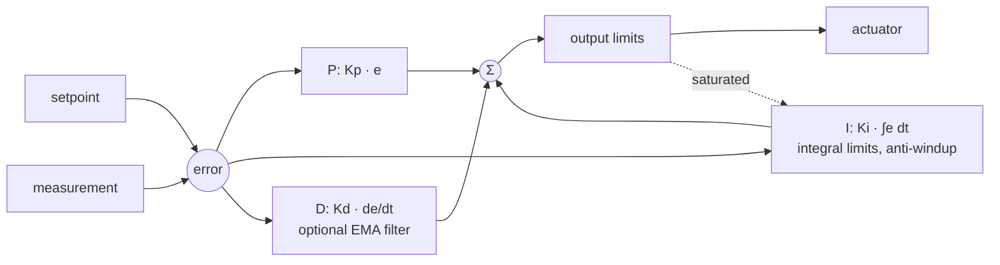

# easyPID

**A hardware-agnostic PID controller for Arduino that makes timing, saturation, noise and its own internal state part of the interface, not an afterthought.**

[](https://www.arduinolibraries.info/libraries/easy-pid)
[](https://github.com/Kronbii/easyPID/actions/workflows/build.yml)

```cpp
#include <easyPID.h>

// Kp, Ki, Kd, and the output limits of a PWM pin
PIDController pid(2.0, 0.5, 0.1, 0.0, 255.0);

void setup() {
  pid.begin();
  pid.setAntiWindup(ANTIWINDUP_CLAMP);
}

void loop() {
  float measurement = analogRead(A0) / 4.0;
  float output = pid.update(100.0, measurement);  // setpoint, measurement
  analogWrite(9, (int)output);
  delay(100);  // a fixed 10 Hz loop
}
```

*The library's BasicPID example, adapted to read a sensor on A0 and drive pin 9.*

## What it is

Most introductions to PID control end at the formula. Real embedded control starts after it: the loop runs late, the actuator saturates, sensor noise swamps the derivative, a second controller has to coexist with the first, and whoever is tuning needs to see what each term is doing instead of guessing from the output.

I wrote easyPID to handle those parts. Each controller is its own object with no global state. It can measure time itself or take the time step from your scheduler, it bounds its output and protects its integral, it can filter the derivative, and it exposes the P, I and D contributions so tuning becomes diagnosis. An optional relay autotuner can find starting gains, with its operating conditions written down.

It grew out of my [two-axis light tracker](https://ramikronbi.com/projects/pid-light-tracking-robot), and it is the PID library used in my [drone-control bootcamp](https://github.com/Kronbii/drone-control-bootcamp), where every lab runs on it.

## Highlights

| | |
|---|---|
| Distribution | Arduino Library Manager, contributed **Device Control** library |
| Releases | 1.0.0 listed 15 January 2026; 1.1.0 on 9 August 2026 |
| Instances | as many as you need, each with its own gains and state |
| Timing | automatic from `millis()`, or an explicit time step in milliseconds |
| Saturation | output limits, optional integral limits, anti-windup by clamping or back-calculation |
| Noise | optional first-order (EMA) low-pass filter on the derivative |
| Introspection | error, P, I and D contributions, and the last output |
| Autotuning | opt-in relay (limit-cycle) tuner with four tuning rules |
| Boards | architecture `*`; CI compiles every example for Uno, Mega 2560 and ESP32 |

## How it works



1. **Instance.** Every loop is a `PIDController` with its own gains, limits and state, so two or ten loops never share anything.
2. **Timing.** `update(setpoint, measurement)` measures the elapsed time from `millis()`. `update(setpoint, measurement, dtMs)` takes the step from you, which lets a scheduler or a test harness own the clock and makes simulations repeatable.
3. **Bound.** The output is clamped to its limits, and the anti-windup mode decides what the integral does while the actuator is saturated, so it does not store up error and overshoot once control returns.
4. **Filter.** An optional low-pass filter on the derivative makes D usable on the noisy sensors people actually connect to microcontrollers.
5. **Inspect.** `getPterm()`, `getIterm()` and `getDterm()` show what each term contributes. If the integral is carrying the system, or the derivative is amplifying noise, you can see it.
6. **Autotune (optional).** `PIDTuner` drives the process into a controlled oscillation with a relay, measures the ultimate gain and period, and turns them into gains with Ziegler–Nichols, Tyreus–Luyben, Pessen or a no-overshoot rule.

## Install

**Arduino IDE.** Open *Tools → Manage Libraries…*, search for **easyPID**, and install it. The examples then appear under *File → Examples → easyPID*.

**Arduino CLI.**

```bash
arduino-cli lib install easyPID
```

**Manually.** Download this repository as a ZIP and use *Sketch → Include Library → Add .ZIP Library…*, or clone it into your sketchbook's `libraries` folder:

```bash
git clone https://github.com/Kronbii/easyPID.git ~/Arduino/libraries/easyPID
```

The sketchbook is `~/Arduino` on Linux and `Documents/Arduino` on Windows and macOS. Restart the IDE afterwards.

## Usage

### One loop, automatic timing

The snippet at the top is the whole pattern: a constructor, `begin()` in `setup()`, and one `update()` per sample. `update()` returns the previous output if no whole millisecond has passed, so it is safe to call from a fast `loop()`.

### Your own time step, and more than one loop

From the MultiLoopPID example: two independent controllers, the second with back-calculation anti-windup and a filtered derivative, both given the sample period explicitly.

```cpp
#include <easyPID.h>

const unsigned long SAMPLE_TIME_MS = 100;

PIDController pid1(1.5, 0.8, 0.05, 0.0, 255.0);   // fast process
PIDController pid2(3.0, 0.3, 0.2, 0.0, 255.0);    // slow, noisy process

unsigned long lastTime = 0;

void setup() {
  pid1.begin();
  pid2.begin();

  pid1.setAntiWindup(ANTIWINDUP_CLAMP);
  pid2.setAntiWindup(ANTIWINDUP_BACKCALC);
  pid2.setDerivativeFilter(FILTER_EMA, 0.7);
}

void loop() {
  unsigned long now = millis();
  if (now - lastTime >= SAMPLE_TIME_MS) {
    lastTime = now;
    float out1 = pid1.update(80.0, analogRead(A0) / 4.0, SAMPLE_TIME_MS);
    float out2 = pid2.update(120.0, analogRead(A3) / 4.0, SAMPLE_TIME_MS);
    analogWrite(9, (int)out1);
    analogWrite(10, (int)out2);
  }
}
```

The time step is in **milliseconds**, not seconds.

### Autotuning

Include `PIDTuner.h` and run the relay until it completes, then hand the gains to the controller. On a unipolar actuator such as a heater or a PWM pin, pass an output bias that holds the process near the setpoint; without it the relay spends half of each period at a drive the hardware clips to zero and tuning times out. This follows the AutoTunePID example:

```cpp
#include <easyPID.h>
#include <PIDTuner.h>

const float SETPOINT = 37.0;

PIDController pid(1.0, 0.0, 0.0, 0.0, 255.0);
PIDTuner tuner(pid);
bool tuned = false;

void setup() {
  pid.begin();
  // setpoint, relay amplitude, noise band, output bias
  tuner.start(SETPOINT, 50.0, 5.0, 127.0);
}

void loop() {
  float measurement = analogRead(A0) / 4.0;

  if (tuner.getState() == TUNER_RELAY_STEP) {
    analogWrite(9, (int)tuner.update(measurement));
  } else if (tuner.isComplete()) {
    if (!tuned) {
      tuned = tuner.applyTunings(TUNING_ZIEGLER_NICHOLS);   // also resets pid
    }
    analogWrite(9, (int)pid.update(SETPOINT, measurement));
  } else if (tuner.getState() == TUNER_FAILED) {
    analogWrite(9, 0);   // no usable oscillation was measured
  }

  delay(50);
}
```

The autotuner deliberately makes the process oscillate. Only run it with safe actuator limits, on a process that tolerates repeated oscillation, and with someone ready to stop it. Treat its gains as a starting point.

All three examples, BasicPID, MultiLoopPID and AutoTunePID, run on a simulated plant, so they need no hardware.

## API reference

### `PIDController` (`#include <easyPID.h>`)

| Method | What it does |
|---|---|
| `PIDController(kp, ki, kd, outMin, outMax)` | Creates a controller. Defaults: `ANTIWINDUP_CLAMP`, no derivative filter, `DIRECT`, no integral limits. |
| `begin()` | Initialises state and timing. Call it in `setup()`. |
| `update(setpoint, measurement)` | Computes the output, measuring the time step from `millis()`. |
| `update(setpoint, measurement, dtMs)` | Computes the output with a time step you supply, in milliseconds. |
| `setSetpoint(sp)`, `setMeasurement(pv)`, `compute()` | The same computation in three calls, for code that sets values in different places. |
| `setTunings(kp, ki, kd)` | Changes the gains at runtime. |
| `setOutputLimits(min, max)` | Clamps the output. Ignored if `min >= max`. |
| `setIntegralLimits(min, max)` | Bounds the raw error-time accumulator (the I term is `Ki` times it). Off until called. |
| `setAntiWindup(mode)` | `ANTIWINDUP_NONE`, `ANTIWINDUP_CLAMP` or `ANTIWINDUP_BACKCALC`. |
| `setDerivativeFilter(mode, alpha = 0.8)` | `FILTER_NONE` or `FILTER_EMA`; a higher `alpha` filters more, clamped to 0–0.999. |
| `setDirection(dir)` | `DIRECT` or `REVERSE` (for example, cooling). Switching at runtime is bumpless. |
| `setSampleTime(ms)` | Records the expected period. Advisory only: it does not gate `update()`. |
| `reset()` | Clears the integral, derivative and error history and restarts the timing reference. |
| `getError()` | `setpoint - measurement`, in either direction. |
| `getPterm()`, `getIterm()`, `getDterm()` | Each term's contribution; they sum to the output before clamping. |
| `getOutput()` | The last computed output. |

### `PIDTuner` (`#include <PIDTuner.h>`, optional)

| Method | What it does |
|---|---|
| `PIDTuner(pid)` | Attaches a tuner to a controller. |
| `start(setpoint, relayAmplitude, noiseBand = 0.5, outputBias = 0)` | Starts a run. The relay swings over `outputBias ± relayAmplitude`. Returns `false` if a run is in progress or the arguments are invalid. |
| `update(measurement)` | Returns the relay output to apply while the state is `TUNER_RELAY_STEP`, and 0 otherwise. |
| `getState()` | `TUNER_IDLE`, `TUNER_RELAY_STEP`, `TUNER_ANALYZING`, `TUNER_COMPLETE` or `TUNER_FAILED`. |
| `isComplete()`, `getProgress()` | Whether results are ready; fraction of the required cycles collected. |
| `getTunings(kp, ki, kd, rule)` | Writes the gains for a rule into your variables. |
| `applyTunings(rule)` | Applies the gains to the attached controller and resets it. |
| `getUltimateGain()`, `getUltimatePeriod()` | The measured Ku and Pu (in seconds). |
| `cancel()` | Stops a run. |

Tuning rules: `TUNING_ZIEGLER_NICHOLS`, `TUNING_TYREUS_LUYBEN`, `TUNING_PESSEN`, `TUNING_NO_OVERSHOOT`.

`DIRECT` and `REVERSE` collide with the macros of the `PID_v1` library. If a sketch uses both, include `easyPID.h` first; the header stops with a clear error otherwise.

## Repository layout

```
src/                  easyPID.h/.cpp (PIDController), PIDTuner.h/.cpp (autotuner)
examples/             BasicPID, MultiLoopPID, AutoTunePID
docs/tuning_guide.md  choosing gains, anti-windup, filtering, autotuning, pitfalls
extras/test/          host tests with a virtual clock; no board needed
library.properties    Library Manager metadata
CHANGELOG.md          release notes
```

The host tests run on your computer with `make -C extras/test test`. Before a pull request, please read [AGENTS.md](AGENTS.md) and [CONTRIBUTING.md](CONTRIBUTING.md).

## Limits and what's next

- **Tuning is system-specific.** Gains that behave on one plant will misbehave on another; the [tuning guide](docs/tuning_guide.md) covers how to find them.
- **Autotuning has consequences.** It needs safe actuator bounds, a process that tolerates oscillation, and a person ready to stop the run.
- **The autotuner reads high on its first run from rest.** Testing it for the bootcamp gave an ultimate gain of about 42 on the first run against an exact 29, and a good value on the second. Until that is fixed, run it twice.
- **Filtering and anti-windup are trade-offs.** The library exposes them as choices instead of hiding them.

## Links

- Project page: [ramikronbi.com/projects/easypid-arduino-library](https://ramikronbi.com/projects/easypid-arduino-library)
- Write-up: [Designing a PID library for real embedded control](https://ramikronbi.com/writing/designing-a-pid-library-for-real-embedded-control)
- Library Manager listing: [arduinolibraries.info/libraries/easy-pid](https://www.arduinolibraries.info/libraries/easy-pid)
- Used in: [drone-control-bootcamp](https://github.com/Kronbii/drone-control-bootcamp)
- Changes: [CHANGELOG.md](CHANGELOG.md). License: MIT, see [LICENSE](LICENSE).

Built by Rami Kronbi — [ramikronbi.com](https://ramikronbi.com)
